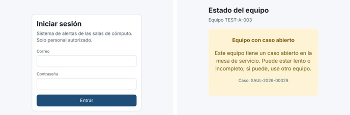
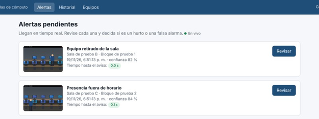
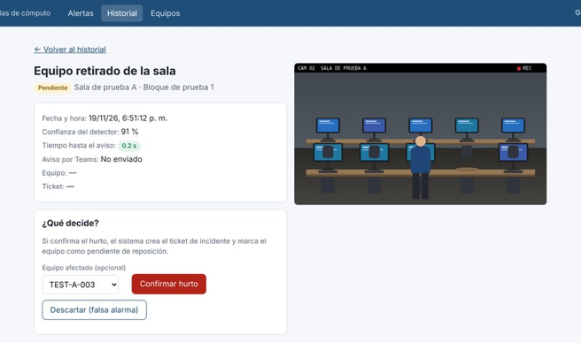
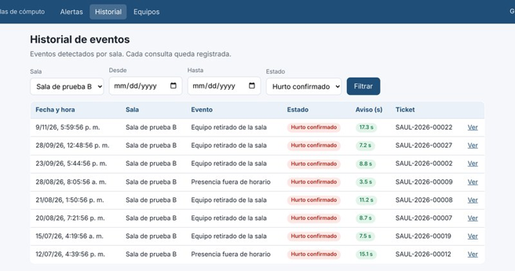
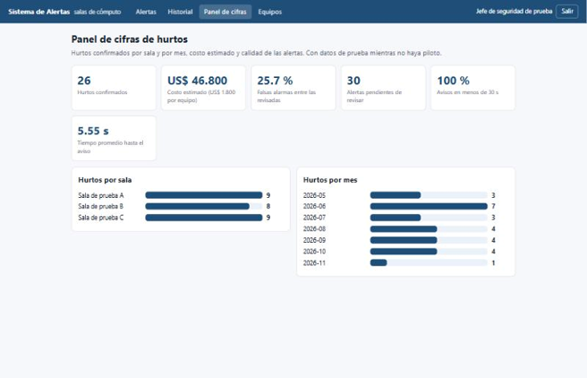
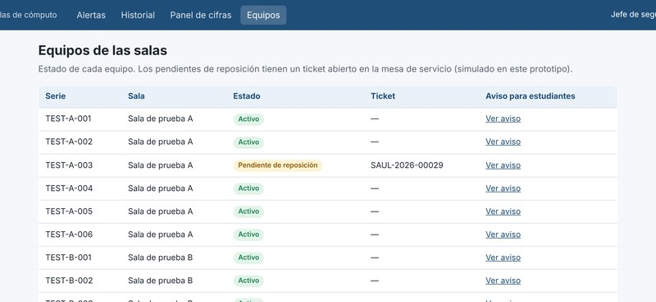

# Manual de usuario breve:

Este manual explica cómo usar la aplicación. Se escribió para tres tipos de usuario: el guardia, el jefe de seguridad y Gestión de Activos. Las capturas son de la aplicación con datos de prueba.
Qué puede hacer cada rol. El guardia y el jefe de seguridad ven las alertas y deciden si cada una es un hurto o una falsa alarma. El jefe de seguridad y Gestión de Activos ven además el panel de cifras. Los tres ven el historial y la lista de equipos, pero Gestión de Activos solo consulta: no confirma ni descarta eventos.

## Entrar y salir: 
Abra la dirección de la aplicación, escriba su correo y su contraseña y pulse "Entrar". La aplicación lo lleva a la pantalla que le corresponde: las alertas para el guardia y el jefe de seguridad, y el panel de cifras para Gestión de Activos. La sesión se cierra sola a las 8 horas; para salir antes, pulse "Salir" arriba a la derecha. Si el correo o la contraseña no son correctos, la aplicación lo avisa y no da pistas de cuál falló.

**Imagen**: A la izquierda, la pantalla de ingreso. A la derecha, la página que ve un estudiante al escanear el QR de un equipo (se explica en el paso 6).

## Atender una alerta (guardia y jefe de seguridad):
En "Alertas" aparecen los eventos pendientes, el más reciente arriba. Las alertas nuevas llegan solas, sin recargar la página. Cada tarjeta muestra el tipo de evento, la sala, la hora, la confianza del detector y los segundos que tardó el aviso. Pulse "Revisar" para abrir el evento.

**Imagen**: Pantalla de alertas pendientes: una tarjeta por evento, con el botón "Revisar".

## Decidir si es hurto o falsa alarma:
En el detalle del evento se ve la imagen de la cámara y los datos del evento. Mire la imagen y decida:
- Si es un hurto: elija el equipo afectado en la lista (es opcional) y pulse "Confirmar hurto". La aplicación crea el ticket de incidente (en este prototipo es simulado) y, si eligió un equipo, lo marca como "Pendiente de reposición". El ticket aparece en el evento.
- Si no lo es: pulse "Descartar (falsa alarma)". El evento queda en el historial como falsa alarma y no genera ticket.

Un evento ya decidido no se puede cambiar. Si se equivocó, la aplicación no deja corregirlo; avise al equipo de desarrollo.

**Imagen**: Detalle de un evento pendiente, con los botones para confirmar el hurto o descartarlo como falsa alarma.

## Consultar el historial (todos los roles):
"Historial" lista todos los eventos. Use los filtros de sala, fechas y estado y pulse "Filtrar". Cada fila tiene la hora, la sala, el tipo de evento, el estado, los segundos del aviso y el número del ticket si lo hay. "Ver" abre el detalle.

**Imagen**: Historial filtrado por sala B y por estado "Hurto confirmado".

## Ver las cifras (jefe de seguridad y Gestión de Activos):
"Panel de cifras" muestra los hurtos confirmados, el costo estimado, el porcentaje de falsas alarmas, las alertas pendientes de revisar y el tiempo promedio del aviso, además de los hurtos por sala y por mes. El costo es una estimación con un valor fijo por equipo, no un dato contable.

**Imagen**: Panel de cifras de la aplicación desplegada.

## Equipos y aviso a los estudiantes (todos los roles):
"Equipos" lista los equipos de cada sala con su estado y el ticket abierto, si lo tiene. Cada equipo tiene un enlace "Ver aviso": es la página a la que lleva el código QR pegado en el equipo. Un estudiante que lo escanea ve si el equipo está activo o si tiene un caso abierto en la mesa de servicio, y así sabe si debe usar otro equipo. Esa página no pide inicio de sesión y no muestra datos de personas.

**Imagen**: Lista de equipos con su estado, el ticket abierto y el enlace al aviso.

## Si algo no funciona:
Si la alerta tarda en aparecer, recargue la página; si la sesión se cerró, vuelva a entrar. Si el problema sigue, escriba al equipo de desarrollo (Simón Banda, Jaime Cotes o David Duarte). Los eventos que llegan del detector se simulan en este prototipo; las cámaras reales no están conectadas.